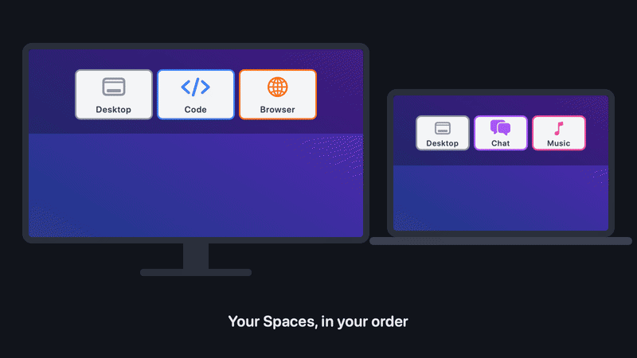
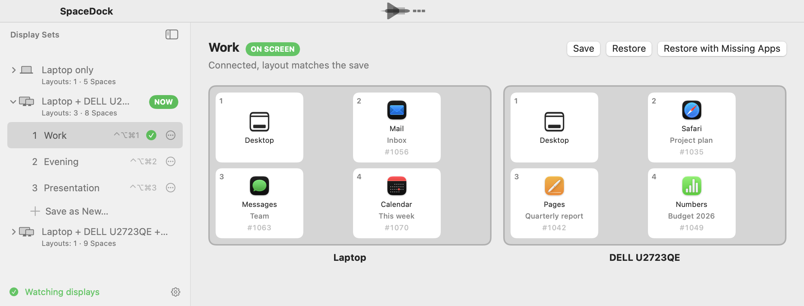
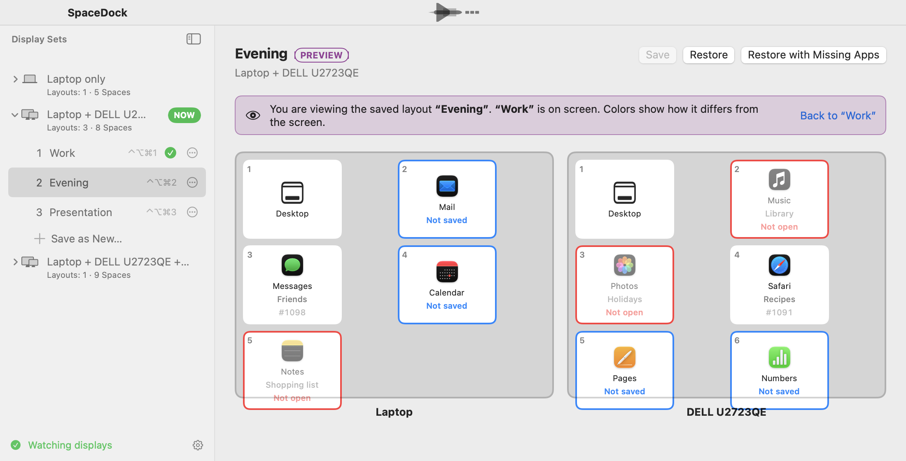

<p align="center">
  <picture>
    <source media="(prefers-color-scheme: dark)" srcset="assets/icon/AppIcon-dark-1024.png">
    
  </picture>
</p>

<h1 align="center">SpaceDock</h1>

<p align="center">
  <b>Keeps your Spaces in order when monitors come and go.</b><br>
  A menu bar app for macOS that remembers the order of your Spaces for every set of displays
  and puts them back after you plug or unplug a monitor.
</p>

<p align="center">
  <a href="../../releases/latest"></a>
  <a href="../../releases"></a>
  
  <a href="LICENSE"></a>
</p>

<!-- Hero animation: tools/readme/shots.sh -->
<p align="center">
  
</p>

macOS shuffles Spaces when monitors come and go: full-screen apps end up on the wrong display or
at the end of the bar, and plugging the monitor back in doesn't undo it. SpaceDock saves the order
of your Spaces for each set of monitors ("Laptop only", "Laptop + DELL", …) and restores it on its
own, or when you click **Restore**.

- **Restores on its own** after a display is connected or disconnected, or by hand from the window,
  the menu bar or a shortcut
- **Several layouts per monitor set** ("Work", "Evening", "Presentation"): switch with a shortcut
  such as <kbd>⌃</kbd><kbd>⌥</kbd><kbd>1</kbd>–<kbd>9</kbd>, and a banner tells you which one is on
- **Reopens missing apps** if you want: **Restore with Missing Apps** launches closed apps first
- **Hides apps that aren't in the layout** (optional): they leave full screen and are minimized,
  never quit
- Tells two windows of the same app apart (e.g. two browser windows) by window and title
- English, Polish, Spanish, Simplified Chinese

## Install

Requires macOS 15 or later. The fastest restore method needs macOS 26; older systems use a slower one.

1. Download `SpaceDock-<version>.dmg` from [Releases](../../releases/latest) and drag `SpaceDock.app`
   to `/Applications`.
2. Open it. SpaceDock is not notarized by Apple, so macOS blocks the first launch. Go to
   **System Settings → Privacy & Security** and click **Open Anyway**. Or, in Terminal:
   ```bash
   xattr -dr com.apple.quarantine /Applications/SpaceDock.app
   ```
3. Click **Grant Permission…** in SpaceDock's window and turn SpaceDock on in
   **System Settings → Privacy & Security → Accessibility**.

Or with [Homebrew](https://brew.sh) (step 2 still applies):
```bash
brew tap wiciow/spacedock
brew trust wiciow/spacedock
brew install --cask spacedock
```

Updates come inside the app: once a day SpaceDock checks the latest release and offers to install
a newer version (or **Check for Updates…** in the menu). Updates are signed, need no Open Anyway
and keep the Accessibility permission.

## Quick start

1. Arrange your Spaces the way you like them on the monitors you have now.
2. Click **Save Current Layout** and give the layout a name.
3. Do the same for every monitor set you use (laptop alone, laptop at the desk, …).
4. Unplug and plug as usual. SpaceDock puts the Spaces back when the displays settle.

More layouts for the same monitors: **Save as New…** in the window or the menu bar.

## A look inside

**Every monitor set with its layouts.** The one on screen has a tick; the window shows its Spaces
display by display.

<picture>
  <source media="(prefers-color-scheme: dark)" srcset="docs/readme/window-dark.png">
  
</picture>

**Preview a layout before you switch.** Click another layout to see it without touching the screen.
Colors show what would change: blue is open now but not in the layout, red is in the layout but
not open.

<picture>
  <source media="(prefers-color-scheme: dark)" srcset="docs/readme/preview-dark.png">
  
</picture>

## Shortcuts

None are set by default; pick them in **Settings → Shortcuts**. They work from any app.

| Shortcut | Does |
|---|---|
| Your choice | Save the layout on screen |
| Your choice | Restore |
| Your choice | Restore with missing apps |
| Modifiers + <kbd>1</kbd>–<kbd>9</kbd>, e.g. <kbd>⌃</kbd><kbd>⌥</kbd><kbd>1</kbd> | Switch to layout 1–9 of the connected monitor set |

<details>
<summary><b>Restore methods</b></summary>

Settings → **Method**:

| Method | How | Speed |
|---|---|---|
| **Direct** (default) | Moves each Space straight to its place and display through a private macOS 26+ window-management operation. No mouse, no Mission Control. | ~0.1 s per Space |
| Drag | Drags thumbnails in Mission Control with a virtual mouse. Needs [Karabiner-Elements](https://karabiner-elements.pqrs.org) and a root helper (see `docs/app.md`). | ~1.2 s per Space |
| Full Screen | Takes windows out of full screen and back in the saved order (a new full-screen Space always goes to the end of the bar). | ~1.5–5 s per Space |

If Direct fails, SpaceDock tries Drag, then Full Screen.
</details>

## FAQ

### Why does SpaceDock need the Accessibility permission?
To read which window is on which Space and to move windows in and out of full screen. Nothing
leaves your Mac.

### Why does macOS block the first launch?
Notarization needs a paid Apple Developer Program membership, and SpaceDock is free. Allow it once
with **Open Anyway**; updates after that install without the prompt.

### Does it use private APIs?
Yes: SkyLight, the framework macOS itself uses for Spaces, to read and move them. It needs no
changes to System Integrity Protection. A macOS update can break these calls; SpaceDock then falls
back to the slower restore methods.

### Should I turn off "Automatically rearrange Spaces based on most recent use"?
Yes (**System Settings → Desktop & Dock → Mission Control**). With it on, macOS reorders Spaces
every time you switch, so the saved order drifts even without a monitor change.

### Does it quit or close my apps?
Never. Hiding apps that aren't in the layout only takes them out of full screen and minimizes them.
Restore with Missing Apps opens closed apps, but they start fresh: SpaceDock does not restore what
was open inside them (e.g. browser tabs).

### Something didn't restore. How do I report it?
Open an [issue](../../issues/new) and attach `~/Library/Logs/SpaceDock.log` (menu bar → **Show Log**).
The log has app names and window numbers, no window titles.

### How do I uninstall it?
Quit SpaceDock, delete the app, then optionally remove `~/Library/Application Support/SpaceDock`,
`~/Library/Logs/SpaceDock.log` and the permission:
```bash
tccutil reset Accessibility io.github.wiciow.spacedock
```

### Can I use it at work?
For noncommercial use, yes. Commercial use needs the author's permission: open an issue.

## Privacy

Everything stays on your Mac. Layouts are in
`~/Library/Application Support/SpaceDock/layout-sets.json` (`layouts.json` from versions before 0.3),
the log in `~/Library/Logs/SpaceDock.log`. Saved layouts contain app names and window titles (a
browser window's title is its open tab). The only network request is the daily update check: it
downloads `appcast.xml` from this repository's latest release (turn it off in Settings).

<details>
<summary><b>Build from source</b></summary>

```bash
tools/make-app.sh && open ~/Applications/SpaceDock.app
```

Signing with your own code-signing certificate keeps the Accessibility permission across
rebuilds: create one in Keychain Access (Certificate Assistant → Create a Certificate, type
"Code Signing") and pass its name:

```bash
SPACEDOCK_SIGN_IDENTITY="My Code Signing" tools/make-app.sh
```

Command-line tools for debugging (`list`, `save`, `restore-bridge`, `spmove`, …) run with the
app's permission through `tools/run-in-app.sh <command>`. Design notes and experiments (in
Polish): `docs/app.md`, `docs/experiments.md`. README pictures: `tools/readme/shots.sh`.
</details>

## Contributing

Found a bug or have an idea? Open an issue first, then a pull request. Translations are welcome.

For fans of Neon Genesis Evangelion and Akira, there's an easter egg.

## License

[PolyForm Noncommercial 1.0.0](LICENSE): SpaceDock is source-available, not open source in the OSI
sense. You may read, change and use it for any noncommercial purpose (personal use, study, hobby
projects, charities, schools). Selling it or using it commercially needs the author's permission:
open an issue.

Bundled third-party parts keep their own licenses: [Sparkle](https://sparkle-project.org) (MIT),
the fonts in `assets/fonts` (SIL Open Font License, texts next to them).
